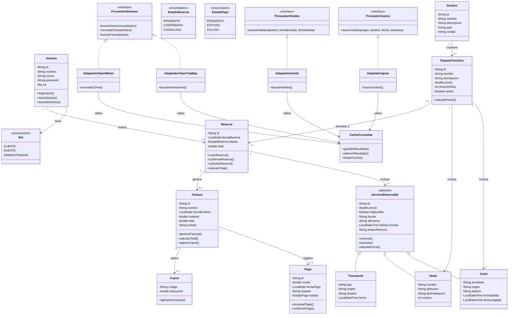

# Diagrama de Clases UML - TravelGo

## 1. Descripción

El diagrama de clases UML representa la estructura del sistema TravelGo hasta el Sprint 5 (v1.0.0), incluyendo las entidades del dominio, sus atributos, métodos, relaciones, herencia e interfaces.

El sistema está desarrollado principalmente en Java con Spring Boot, siguiendo los principios de programación orientada a objetos y una arquitectura por capas.

## 2. Diagrama de clases



## 3. Descripción de las clases

| Clase | Responsabilidad |
|---|---|
| Usuario | Gestionar los datos y autenticación de los usuarios. |
| Rol | Definir los perfiles de acceso del sistema. |
| Destino | Representar los destinos turísticos. |
| PaqueteTuristico | Gestionar los paquetes ofrecidos por la agencia. |
| Reserva | Gestionar las reservas de los clientes. |
| EstadoReserva | Definir los estados posibles de una reserva. |
| ServicioReservable | Clase abstracta para los servicios turísticos. |
| Vuelo | Representar los servicios de transporte aéreo. |
| Hotel | Representar los servicios de alojamiento. |
| Transporte | Representar los servicios de transporte. |
| Factura | Gestionar la facturación de las reservas. |
| Pago | Registrar y procesar los pagos simulados. |
| EstadoPago | Definir los estados de los pagos. |
| Cupon | Gestionar los descuentos aplicables a las facturas. |
| ProveedorVuelos | Definir la interfaz para consultar vuelos. |
| ProveedorHoteles | Definir la interfaz para consultar hoteles. |
| ProveedorDestinos | Definir la interfaz para consultar información turística. |
| AdaptadorIgnav | Adaptar las respuestas de Ignav al modelo de TravelGo. |
| AdaptadorXotelo | Adaptar las respuestas de Xotelo al modelo de TravelGo. |
| AdaptadorOpenTripMap | Adaptar información de atracciones turísticas. |
| AdaptadorOpenMeteo | Adaptar información meteorológica. |
| CacheConsultas | Almacenar temporalmente resultados de consultas externas. |

## 4. Relaciones entre las clases

- Usuario y Rol: cada usuario tiene un rol que determina sus permisos.
- Usuario y Reserva: un usuario puede realizar múltiples reservas.
- Destino y PaqueteTuristico: un destino puede estar asociado a varios paquetes.
- PaqueteTuristico y Vuelo: un paquete incluye un vuelo seleccionado.
- PaqueteTuristico y Hotel: un paquete incluye un hotel seleccionado.
- PaqueteTuristico y Reserva: una reserva puede estar asociada a un paquete.
- Reserva y ServicioReservable: una reserva incluye uno o varios servicios.
- ServicioReservable y sus subclases: Vuelo, Hotel y Transporte heredan de la clase abstracta.
- Reserva y Factura: una reserva puede generar una factura.
- Factura y Pago: una factura registra el pago correspondiente.
- Factura y Cupon: una factura puede tener asociado un cupón de descuento.
- Proveedores y adaptadores: los adaptadores implementan las interfaces de consulta de servicios externos.
- Adaptadores y CacheConsultas: los adaptadores utilizan caché para evitar consultas innecesarias a las APIs.

## 5. Herencia, abstracción e interfaces

La clase ServicioReservable se define como abstracta porque contiene los atributos y comportamientos comunes de los servicios turísticos.

Las clases Vuelo, Hotel y Transporte heredan de ServicioReservable.

Las interfaces ProveedorVuelos, ProveedorHoteles y ProveedorDestinos permiten desacoplar la lógica de negocio de los servicios externos.

Los adaptadores implementan estas interfaces y convierten las respuestas de las APIs externas en objetos compatibles con el modelo de TravelGo.

## 6. Principios de diseño aplicados

- Encapsulamiento: los atributos se declaran privados.
- Herencia: Vuelo, Hotel y Transporte heredan de ServicioReservable.
- Abstracción: ServicioReservable define el comportamiento común.
- Polimorfismo: los diferentes servicios pueden utilizarse mediante su clase base.
- SRP: cada clase tiene una responsabilidad específica.
- DIP: los servicios dependen de interfaces y no de implementaciones concretas.
- OCP: se pueden incorporar nuevos proveedores mediante adaptadores.
- ISP: cada proveedor tiene una interfaz específica.

## 7. Consideraciones técnicas

- El sistema utiliza Java y Spring Boot.
- La persistencia se realiza mediante PostgreSQL.
- La seguridad y los permisos se gestionan mediante Spring Security.
- Los pagos son simulados; no se emiten tiquetes ni se realizan reservas reales en aerolíneas u hoteles.
- Los precios de vuelos y hoteles son valores de referencia y conservan su fuente y fecha de consulta.
- Las consultas externas utilizan mecanismos de caché para controlar el consumo de las APIs.
- El diagrama representa la estructura conceptual del dominio y los componentes de integración hasta el Sprint 5.
- Las funcionalidades opcionales no implementadas no deben considerarse parte del alcance funcional definitivo.
```
