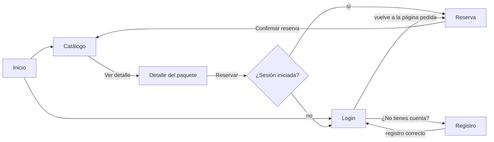
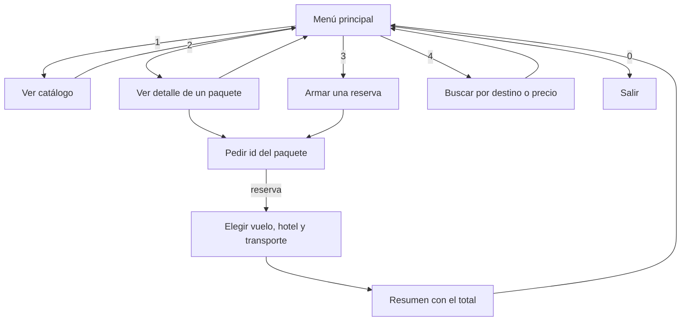

# Wireframes y Flujo de Pantallas - TravelGo

## 1. Descripción

Este documento presenta los wireframes de las pantallas principales de TravelGo (inicio, login, registro, catálogo, detalle del paquete y reserva) y el flujo de navegación entre ellas.

Cada pantalla usa los atributos definidos en el [Diagrama de Clases](DiagramaDeClases.md) y en el [Modelo Entidad-Relación](ModeloER.md).

## 2. Flujo de pantallas



- **Pantallas públicas:** inicio, login, registro, catálogo y detalle.
- **Pantalla privada:** reserva. Si el usuario no ha iniciado sesión, va al login y después vuelve a la reserva.

## 3. Wireframes

### 3.1 Login

```text
+------------------------------------------+
| TravelGo        Inicio  Catálogo  Login  |
+------------------------------------------+
|            Iniciar sesión                |
|   Correo      [______________________]   |
|   Contraseña  [______________________]   |
|               [      Ingresar       ]    |
|   ¿No tienes cuenta? Regístrate          |
+------------------------------------------+
```

### 3.2 Registro

```text
+------------------------------------------+
|              Crear cuenta                |
|   Nombre               [______________]  |
|   Correo               [______________]  |
|   Contraseña           [______________]  |
|   Confirmar contraseña [______________]  |
|               [    Registrarme    ]      |
+------------------------------------------+
```

Los campos corresponden a `Usuario` (nombre, correo, password). El rol se asigna como `CLIENTE`.

### 3.3 Catálogo

```text
+------------------------------------------+
|  Paquetes turísticos                     |
|  Destino [______] Mín [___] Máx [___]   |
|  [Filtrar] [X]                           |
|  +------------+ +------------+ +-------+ |
|  | Nombre     | | Nombre     | | ...   | |
|  | Ciudad, País| | Ciudad, País|        | |
|  | N días     | | N días     | |       | |
|  | Descripción| | Descripción| |       | |
|  | USD precio | | USD precio | |       | |
|  | [Ver detalle]| [Ver detalle]|       | |
|  +------------+ +------------+ +-------+ |
+------------------------------------------+
```

Solo se muestran los paquetes con `activo = true`. Se pueden filtrar por destino (ciudad o país) y por rango de precios (Historia 3).

### 3.4 Detalle del paquete

```text
+------------------------------------------+
| Catálogo > Nombre del paquete            |
| +----------------------+ +-------------+ |
| | Nombre               | | Precio      | |
| | Ciudad, País         | | USD precio  | |
| | Descripción          | | N días      | |
| | Sobre el destino:    | | [Reservar]  | |
| | nombre y descripción | +-------------+ |
| +----------------------+                 |
+------------------------------------------+
```

### 3.5 Reserva

```text
+------------------------------------------+
| Arma tu reserva                          |
| +----------------------+ +-------------+ |
| | Vuelo                | | Resumen     | |
| | ( ) aerolínea, origen| | Paquete     | |
| |     → destino, fechas| | Extras      | |
| | ( ) Sin vuelo        | | Total       | |
| | Hotel                | | [Confirmar] | |
| | ( ) nombre, noches   | +-------------+ |
| | ( ) Sin hotel        |                 |
| | Transporte           |                 |
| | ( ) tipo, fecha      |                 |
| | ( ) Sin transporte   |                 |
| +----------------------+                 |
+------------------------------------------+
```

El total se actualiza al elegir cada opción: precio del paquete + `calcularPrecio()` de cada servicio elegido.

## 4. Relación entre pantallas y clases

| Pantalla | Clases que usa | Atributos / métodos |
|---|---|---|
| Login | Usuario | correo, password |
| Registro | Usuario, Rol | nombre, correo, password, rol = CLIENTE |
| Catálogo | PaqueteTuristico, Destino | nombre, descripcion, precio, duracionDias, activo, destino.ciudad, destino.pais |
| Detalle | PaqueteTuristico, Destino | los del catálogo + destino.nombre, destino.descripcion |
| Reserva | Reserva, Vuelo, Hotel, Transporte | aerolinea, origen, destino, fechaSalida, fechaLlegada; nombre, direccion, tipoHabitacion, noches; tipo, fecha; calcularPrecio() |

## 5. Versión en consola

Para la presentación del primer modelo, el catálogo, el detalle y la reserva también se muestran en consola con la clase `ConsolaMaqueta`.



```text
=== TravelGo ===
1. Ver catálogo
2. Ver detalle de un paquete
3. Armar una reserva
4. Buscar paquetes por destino o precio
0. Salir
Opción: 3
```

## 6. Consideraciones técnicas

- Las pantallas se construyen con Thymeleaf y Bootstrap 5.
- Mientras no existan las entidades reales, las pantallas usan datos de ejemplo del paquete `maqueta/`, con los mismos atributos que el diagrama de clases.
