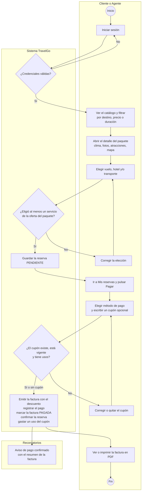
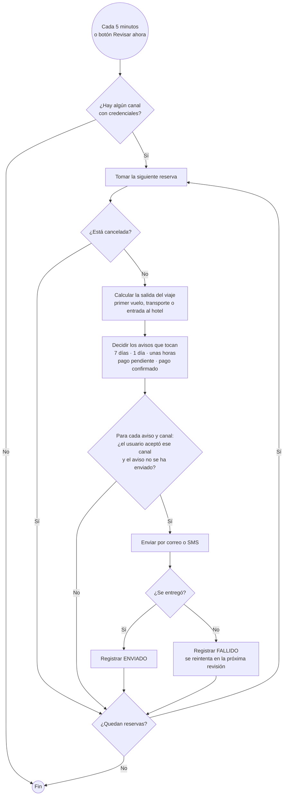

# Diagramas de actividades — TravelGo (Sprint 5, Integrante 3)

Dos actividades principales del sistema: **reservar y pagar un paquete** (cliente o agente) y **enviar recordatorios**
(servicio programado). Se dibujan con carriles (quién hace cada paso) usando Mermaid; en el documento final se pueden
pasar a UML con la misma forma.

## 1. Reservar y pagar un paquete

Notas:
- El **agente** ve las reservas de todos los clientes y puede pagar cualquiera; el **cliente** solo las suyas
  (`docs/matriz_permisos.md`). El dueño de la reserva sale de la sesión, no del formulario.
- El pago es simulado y se guarda en una sola transacción: todo o nada.
- Una reserva PENDIENTE que no se paga en 2 días recibe el aviso de pago pendiente (actividad 2).

## 2. Enviar recordatorios (cada 5 minutos)

Notas:
- El registro (`envio_recordatorio`, `UNIQUE (reserva_id, tipo, canal)`) impide repetir un aviso.
- Detalle del diseño en `docs/recordatorios.md`.
