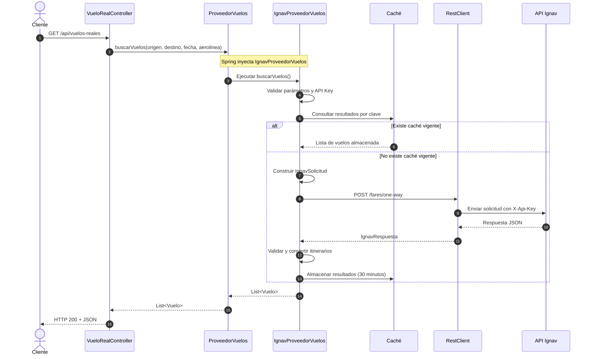
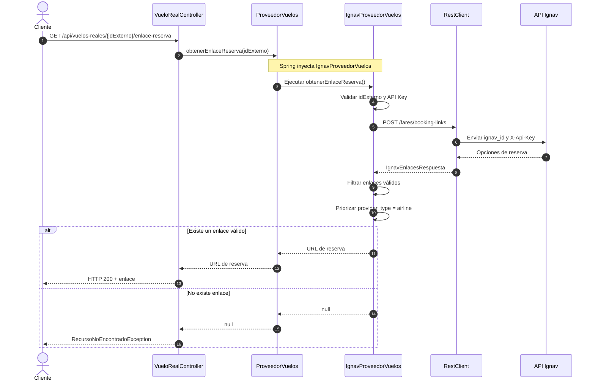

# Diagrama de Secuencia – Consulta de Vuelos Reales

## 1. Objetivo

Representar la interacción entre los componentes de TravelGo y el proveedor externo Ignav durante la búsqueda de vuelos reales y la obtención de enlaces externos de reserva.

## 2. Participantes

- **Cliente:** realiza las solicitudes HTTP.
- **VueloRealController:** recibe y procesa las solicitudes REST.
- **ProveedorVuelos:** interfaz que define las operaciones de consulta.
- **IgnavProveedorVuelos:** implementación que integra TravelGo con Ignav.
- **Caché:** almacena temporalmente los resultados de búsqueda.
- **RestClient:** cliente HTTP configurado para comunicarse con Ignav.
- **API Ignav:** proveedor externo de información de vuelos.

## 3. Secuencia de búsqueda de vuelos

## 4. Secuencia de obtención del enlace de reserva

## 5. Consideraciones técnicas

- La integración utiliza la interfaz `ProveedorVuelos` para desacoplar el controlador del proveedor externo.
- `IgnavProveedorVuelos` implementa el patrón Adapter para transformar las respuestas de Ignav en objetos `Vuelo`.
- Los resultados de búsqueda se almacenan en una caché concurrente durante 30 minutos.
- La consulta externa utiliza `RestClient`.
- Las solicitudes a Ignav incluyen la cabecera `X-Api-Key`.
- Los precios recibidos son valores de referencia y no garantizan disponibilidad al momento de reservar.
- La integración maneja errores de comunicación con el proveedor sin propagar directamente las excepciones HTTP al controlador.
- Los enlaces de reserva se obtienen directamente del proveedor externo y se priorizan los correspondientes a las aerolíneas.

## 6. Endpoints implementados

| Método | Endpoint | Descripción |
|---|---|---|
| GET | `/api/vuelos-reales` | Buscar vuelos reales por origen, destino, fecha y aerolínea opcional. |
| GET | `/api/vuelos-reales/{idExterno}/enlace-reserva` | Obtener el enlace externo de reserva de un vuelo. |
