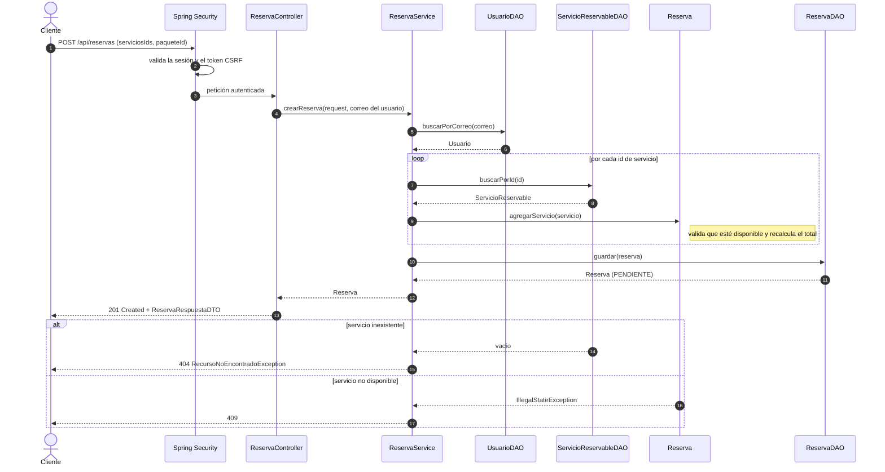
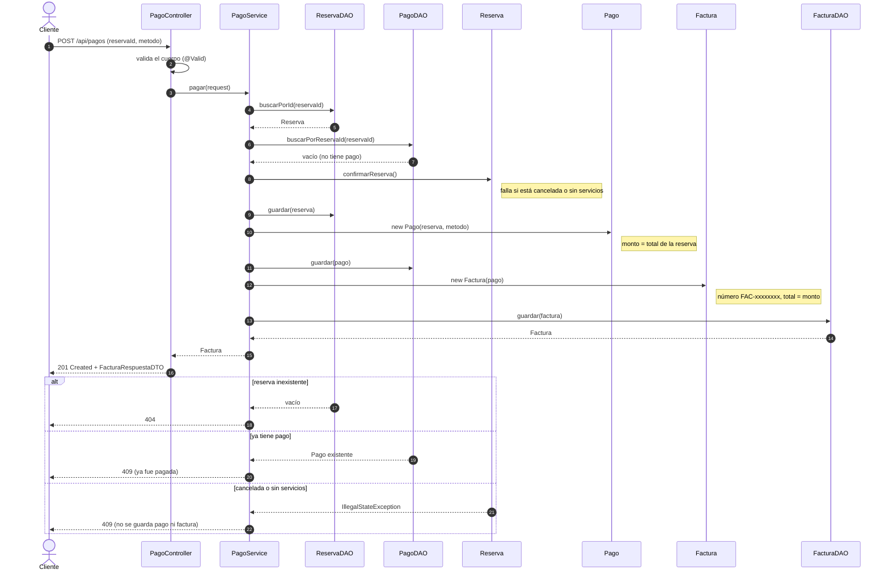
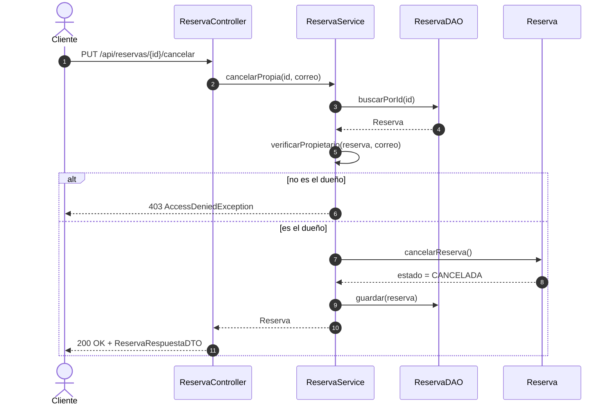
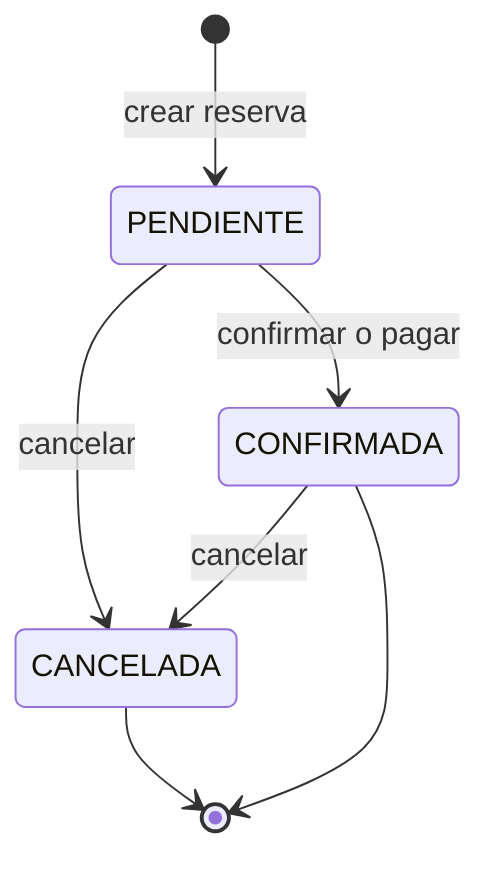

# Casos de uso y diagramas de secuencia — Reservas y pagos

Apoyo a la documentación de Ingeniería de Software I. Está escrito sobre el código actual de `develop` (capas Controller → Service → DAO) y sobre `matriz_permisos.md`. Los diagramas usan Mermaid (GitHub los dibuja solo).

## 1. Actores
| Actor | Descripción |
|---|---|
| Cliente | Persona registrada que consulta el catálogo, reserva y paga sus propias reservas |
| Agente | Empleado de la agencia: gestiona todas las reservas y pagos |
| Administrador | Gestiona el catálogo (destinos, paquetes y servicios) |
| Sistema | Genera la factura al confirmarse un pago |

## 2. Diagrama de casos de uso

```mermaid
flowchart LR
    Cliente([Cliente])
    Agente([Agente])
    Admin([Administrador])

    subgraph TravelGo
        CU01(CU-01 Registrarse)
        CU02(CU-02 Iniciar sesión)
        CU03(CU-03 Consultar catálogo)
        CU04(CU-04 Gestionar catálogo)
        CU05(CU-05 Crear reserva)
        CU06(CU-06 Cancelar reserva)
        CU07(CU-07 Confirmar reserva)
        CU08(CU-08 Pagar reserva)
        CU09(CU-09 Consultar factura)
        CU10(CU-10 Generar factura)
    end

    Cliente --- CU01
    Cliente --- CU02
    Cliente --- CU03
    Cliente --- CU05
    Cliente --- CU06
    Cliente --- CU08
    Cliente --- CU09
    Agente --- CU02
    Agente --- CU03
    Agente --- CU06
    Agente --- CU07
    Agente --- CU08
    Agente --- CU09
    Admin --- CU02
    Admin --- CU03
    Admin --- CU04
    CU08 -. include .-> CU10
```

## 3. Especificación de los casos de uso de reservas y pagos

### CU-05 Crear reserva
| | |
|---|---|
| Actores | Cliente (también Agente) |
| Precondición | Tiene sesión iniciada |
| Flujo principal | 1. Elige uno o más servicios disponibles (vuelo, hotel, transporte) y, opcionalmente, un paquete. 2. Envía la reserva. 3. El sistema toma el usuario de la sesión, valida cada servicio y calcula el total (vuelo y transporte = precio; hotel = precio × noches). 4. Guarda la reserva en estado PENDIENTE y la muestra. |
| Flujos alternos | A1. Un servicio no existe → error 404, no se guarda nada. A2. Un servicio no está disponible → error 409. A3. No eligió servicios → error 400. A4. El paquete no existe → error 404. |
| Postcondición | Existe una reserva PENDIENTE a nombre del usuario autenticado |
| Reglas | El dueño nunca se toma del cuerpo de la petición. Si un servicio falla, no queda una reserva a medias. |

### CU-06 Cancelar reserva
| | |
|---|---|
| Actores | Cliente (sus reservas), Agente (todas) |
| Precondición | La reserva existe y no está cancelada |
| Flujo principal | 1. Pide cancelar. 2. El sistema verifica permiso. 3. Cambia el estado a CANCELADA. |
| Flujos alternos | A1. Ya estaba cancelada → 409. A2. Reserva de otro cliente (siendo Cliente) → 403. A3. No existe → 404. |
| Postcondición | Reserva CANCELADA; ya no se puede confirmar, pagar ni agregar servicios |

### CU-07 Confirmar reserva
| | |
|---|---|
| Actores | Agente |
| Precondición | Reserva PENDIENTE con al menos un servicio |
| Flujo principal | 1. El agente confirma. 2. El sistema recalcula el total y cambia el estado a CONFIRMADA. |
| Flujos alternos | A1. Sin servicios → 409. A2. Cancelada → 409. A3. No existe → 404. |
| Nota | Pagar también confirma la reserva (ver CU-08). |

### CU-08 Pagar reserva
| | |
|---|---|
| Actores | Cliente (sus reservas), Agente |
| Precondición | Reserva con servicios, no cancelada y sin pago previo |
| Flujo principal | 1. Elige el método de pago (tarjeta de crédito, tarjeta de débito, transferencia o efectivo). 2. El sistema confirma la reserva. 3. Registra el pago por el total de la reserva. 4. Genera la factura (CU-10). 5. Muestra la factura. |
| Flujos alternos | A1. La reserva ya fue pagada → 409. A2. Está cancelada → 409. A3. No tiene servicios → 409. A4. No existe → 404. A5. Método inválido o ausente → 400. A6. Cliente pagando una reserva ajena → 403 (regla de la matriz; ver defecto D3). |
| Postcondición | Reserva CONFIRMADA, un pago y una factura asociados |
| Reglas | Una reserva se paga una sola vez. El monto es siempre el total de la reserva. |

### CU-10 Generar factura (incluido en CU-08)
| | |
|---|---|
| Actor | Sistema |
| Flujo | Crea la factura a partir del pago: número `FAC-` + 8 caracteres, fecha de emisión de hoy y total igual al monto del pago |

### CU-09 Consultar factura
| | |
|---|---|
| Actores | Cliente (las suyas), Agente (todas) |
| Flujo principal | Pide la factura por id o por reserva; el sistema la muestra sin exponer datos sensibles del usuario (contraseña) |
| Flujo alterno | La reserva no tiene factura → 404 |

## 4. Diagramas de secuencia

### 4.1 Crear reserva

> El diagrama muestra el comportamiento correcto: el usuario se busca por **correo**. El código actual de `develop` lo busca por id y por eso falla (defecto D1 del reporte de pruebas).

### 4.2 Pagar una reserva (confirma y factura)

### 4.3 Cancelar o confirmar una reserva propia

## 5. Estados de una reserva

## 6. Trazabilidad con las historias de usuario
| Historia | Caso de uso |
|---|---|
| 5 Crear reserva | CU-05 |
| 6 Confirmar reserva | CU-07 |
| 7 Generar factura | CU-10 |
| 8 Registrar pago | CU-08 |
| 1 Registro, 2 Inicio de sesión | CU-01, CU-02 |
| 3 Consultar catálogo, 4 Gestión de paquetes | CU-03, CU-04 |
