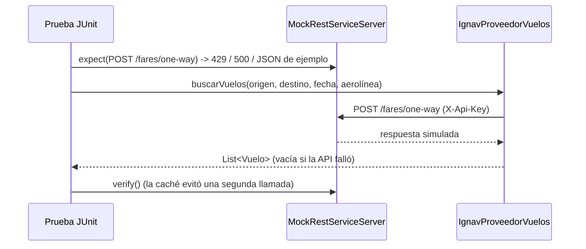

# Datos, pruebas y búsqueda — Sprint 4 (Integrante 4)

Rama: `feature/datos-pruebas`. Documentación de esta parte: diagrama de secuencia y tabla GRASP/SOLID.
La verificación de las APIs está en `docs/verificacion_apis.md`.

## 1. Estado de las tareas

| Tarea | Estado |
|---|---|
| Esquema: cupones (las columnas de referencia las agregó Integrante 1) | Hecha |
| Datos reales en `data.sql` | Pendiente: falta la consulta real a Ignav y a Xotelo, con su fecha |
| Pruebas de proveedores con respuestas simuladas | Hechas para vuelos (Ignav) y hoteles (Xotelo, casos de fallo). Destinos: pendiente |
| Colección de Postman | `postman/TravelGo-Sprint4.postman_collection.json` (búsqueda, destinos, hoteles). Faltan vuelos y paquetes reales |
| Búsqueda y filtros en el backend | Hecha: destino, precio y duración. Aerolínea y fechas esperan paquetes con vuelos reales |
| Opcional: chatbot simple | No iniciado |

## 2. Diagrama de secuencia: búsqueda de paquetes con filtros

```mermaid
sequenceDiagram
    actor U as Usuario autenticado
    participant C as PaqueteController
    participant S as PaqueteService
    participant D as PaqueteDAO
    participant DB as PostgreSQL

    U->>C: GET /api/paquetes/buscar?destino=&precioMax=&duracionMin=
    C->>S: buscar(destino, precioMin, precioMax, duracionMin, duracionMax)
    S->>S: validar rangos (mínimo no mayor que máximo)
    S->>D: listarActivos()
    D->>DB: SELECT paquetes activos (con destinos)
    DB-->>D: filas
    D-->>S: List<PaqueteTuristico>
    S->>S: aplicar filtros (Y); destino sin tildes ni mayúsculas
    S-->>C: paquetes que cumplen
    C-->>U: 200 + JSON (o 400 si el rango es inválido)
```

## 3. Diagrama de secuencia: prueba de un proveedor con respuestas simuladas



## 4. SOLID y GRASP en esta parte

| Principio | Aplicación |
|---|---|
| Responsabilidad única (S) | `PaqueteService.buscar` solo filtra; el acceso a datos sigue en `PaqueteDAO` |
| Abierto/cerrado (O) | Agregar un filtro nuevo es agregar una condición en `buscar`, sin tocar el DAO ni los proveedores |
| Inversión de dependencias (D) | Las pruebas usan `RestClient` con un servidor simulado y `PaqueteDAO` simulado con Mockito: el código no depende de internet ni de la base de datos |
| Experto en información (GRASP) | `PaqueteService` conoce los paquetes y sus destinos, así que es quien filtra |
| Controlador (GRASP) | `PaqueteController` solo recibe los parámetros y delega en el servicio |
| Variaciones protegidas | El esquema guarda la referencia externa en columnas opcionales: un servicio manual y uno real conviven sin cambios |
