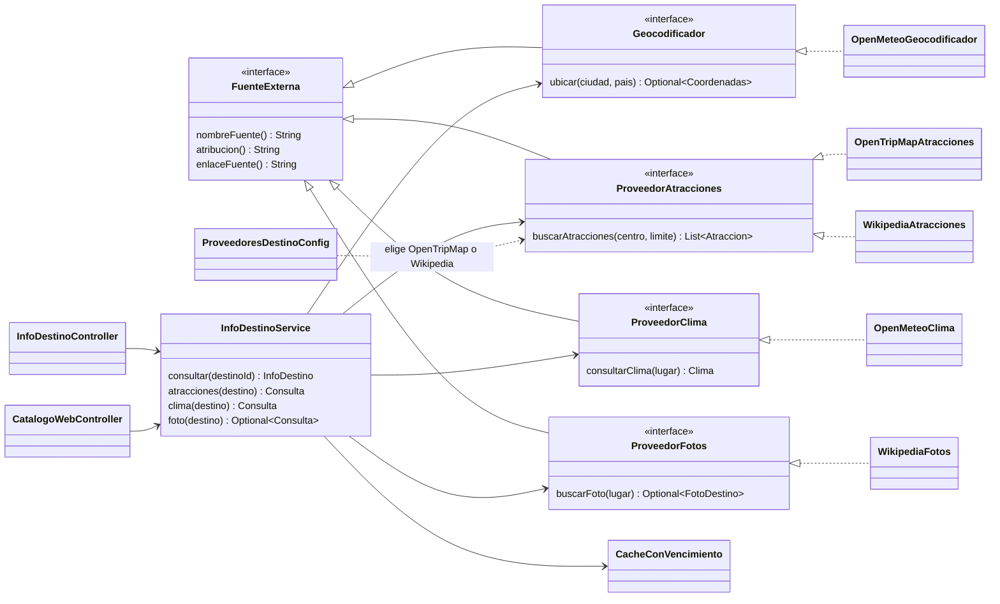
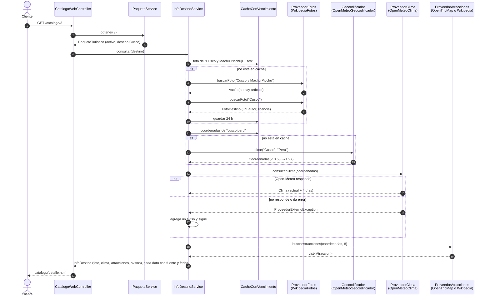

# Destinos reales y web — Sprint 4 (Integrante 3)

Rama: `feature/destinos-web`. Este documento tiene la verificación de las APIs de destinos, el diseño de
`ProveedorDestinos`, los endpoints, el diagrama de secuencia y la tabla GRASP/SOLID de esta parte.

## 1. Qué se hizo

| Tarea del Sprint 4 | Estado |
|---|---|
| Verificación de APIs: OpenTripMap, Geoapify, Open-Meteo y fotos | Hecha para Open-Meteo y fotos. OpenTripMap y Geoapify esperan la llave gratuita (ver 2) |
| ProveedorDestinos: atracciones, clima y fotos con atribución, y endpoints | Hecha |
| La web usa la base de datos (reemplazar `BackendConsola` por los services de Spring) | Hecha |
| Constructor de paquetes en la web | **Bloqueada:** espera `ProveedorVuelos` (Integrante 1) y `ProveedorHoteles` + armado de paquetes (Integrante 2). Wireframe listo en `Diagramas/Wireframes.md` (sección 7) |
| Opcional: pulido responsive y filtros en la interfaz | Hecha: filtro por duración, tarjetas con foto, ajustes para pantallas pequeñas |

## 2. Verificación de APIs (aporte para el documento de Integrante 4)

Prueba hecha el 2026-11-06 con los destinos de `data.sql`: Cartagena, Bogotá, Cusco y Cancún.

| API | Para qué | Llave | Resultado | Detalle | Atribución obligatoria |
|---|---|---|---|---|---|
| Open-Meteo Forecast | Clima actual y pronóstico de 4 días | No | **Pasó** | Respondió para los 4 destinos. Temperaturas en °C, estado del cielo con códigos WMO | "Weather data by Open-Meteo.com", licencia CC BY 4.0. Gratis para uso no comercial |
| Open-Meteo Geocoding | Pasar de ciudad a coordenadas | No | **Pasó** | Encontró las 4 ciudades. Hay que filtrar por país: "Cartagena" también existe en España | Datos de GeoNames, CC BY 4.0 |
| Wikipedia REST (`page/summary`) + Wikimedia Commons (`imageinfo`) | Foto del destino con autor y licencia | No | **Pasó** | 1 foto por destino con autor y licencia (CC BY 2.0, CC BY-SA 2.0, CC BY-SA 4.0). "Cusco y Machu Picchu" no tiene artículo: se busca por la ciudad | Autor + licencia + enlace a Commons en cada foto. Wikimedia pide un User-Agent que identifique la app |
| Wikipedia `geosearch` | Atracciones (respaldo sin llave) | No | **Pasó con límites** | 4 a 8 lugares reales por destino (Coricancha, Castillo San Felipe, Catedral de Cancún...). No trae dirección: se muestra la distancia al centro. Trae también barrios y batallas, por eso se filtran | Textos de Wikipedia, CC BY-SA 4.0 |
| OpenTripMap | Atracciones con nombre, dirección y coordenadas | Sí (gratis) | **Pendiente** | Sin llave responde 401. El adaptador ya está hecho; falta probarlo con la llave (comandos abajo) | Datos © colaboradores de OpenStreetMap (ODbL) |
| Geoapify Places | Atracciones y hoteles con dirección | Sí (gratis) | **Pendiente** | No se hizo adaptador: OpenTripMap y Wikipedia cubren las atracciones. Sirve como datos de apoyo para los hoteles de Integrante 2 | © OpenStreetMap contributors, "Powered by Geoapify" |
| Overpass API (OpenStreetMap) | Alternativa sin llave para atracciones | No | **No pasó** | No respondió en la prueba. Se descarta: es un servidor compartido con límites estrictos | — |

Moneda: ninguna de estas APIs devuelve precios. Cuotas: los resultados se guardan en caché
(clima 1 hora, atracciones y fotos 24 horas, coordenadas 7 días), así que cada destino gasta pocas consultas al día.

### Cómo terminar la verificación de OpenTripMap y Geoapify

1. Crear una cuenta gratuita en <https://dev.opentripmap.org/> y en <https://myprojects.geoapify.com/>.
2. Probar con PowerShell (cambiar `TU_LLAVE`):

```powershell
# OpenTripMap: atracciones cerca del centro de Cartagena
curl.exe "https://api.opentripmap.com/0.1/es/places/radius?radius=10000&lat=10.4236&lon=-75.5253&kinds=interesting_places&rate=2&format=json&limit=10&apikey=TU_LLAVE"

# Geoapify: atracciones y hoteles cerca del centro de Cusco
curl.exe "https://api.geoapify.com/v2/places?categories=tourism.sights&filter=circle:-71.9675,-13.5319,5000&limit=10&apiKey=TU_LLAVE"
curl.exe "https://api.geoapify.com/v2/places?categories=accommodation.hotel&filter=circle:-71.9675,-13.5319,5000&limit=10&apiKey=TU_LLAVE"
```

3. Si responden con nombres, direcciones y coordenadas para los tres destinos, cambiar "Pendiente" por "Pasó".
4. Para que TravelGo use OpenTripMap, poner la llave en una variable de entorno (nunca en el repositorio) y arrancar la app:

```powershell
$env:OPENTRIPMAP_API_KEY = "TU_LLAVE"
./mvnw spring-boot:run
```

Al arrancar, el log dice `Atracciones: OpenTripMap.` (sin llave dice `...se consultan en Wikipedia.`).

## 3. Diseño



- Paquete `com.travelgo.proveedor.destinos`: interfaces, adaptadores, modelos (`Coordenadas`, `Atraccion`,
  `Clima`, `FotoDestino`, `Consulta`, `InfoDestino`), caché y configuración.
- `Consulta<T>` guarda cada dato con su fuente, su atribución y la fecha de la consulta (regla del sprint:
  "todo dato real se muestra con su fecha de consulta y su fuente").
- Los destinos solo guardan ciudad y país; las coordenadas se piden a Open-Meteo y se guardan en caché.
  Por eso no hubo que cambiar el `schema.sql`.
- Si una API falla, el adaptador lanza `ProveedorExternoException` con un mensaje claro (cuota agotada, llave
  inválida, sin respuesta). `InfoDestinoService.consultar` la convierte en un aviso y sigue con lo demás.
- La información de destinos **no** se guarda en la base de datos: se consulta y se guarda en caché. El precio
  del paquete sí se guarda (es el que copia el constructor de paquetes de Integrante 2).

### Endpoints

Todos son GET y piden sesión iniciada (`SecurityConfig`: `GET /api/destinos/**` → autenticado).

| Endpoint | Respuesta | Si la API falla |
|---|---|---|
| `GET /api/destinos/{id}/info` | Foto, clima y atracciones juntos, con `avisos` | 200 con la parte en `null` y el motivo en `avisos` |
| `GET /api/destinos/{id}/atracciones` | `Consulta` con la lista de atracciones | 503 `{"error", "fuente"}` |
| `GET /api/destinos/{id}/clima` | `Consulta` con el clima actual y el pronóstico | 503 |
| `GET /api/destinos/{id}/foto` | `Consulta` con la foto, el autor y la licencia | 503; 404 si no hay foto |

Destino que no existe: 404 (lo maneja `GlobalExceptionHandler`).

Ejemplo (resumido) de `GET /api/destinos/3/clima`:

```json
{
  "datos": { "temperaturaActual": 20.8, "descripcion": "Nublado", "icono": "bi-clouds",
             "dias": [ { "fecha": "2026-11-06", "minima": 7.8, "maxima": 22.4, "descripcion": "Niebla" } ] },
  "fuente": "Open-Meteo",
  "atribucion": "Datos del clima: Open-Meteo.com (CC BY 4.0)",
  "enlaceFuente": "https://open-meteo.com/",
  "consultadoEn": "2026-11-06T12:30:00"
}
```

### Web

| Página | Qué cambió |
|---|---|
| `/catalogo` | Paquetes activos de PostgreSQL (`PaqueteService`), foto real del destino con su crédito, precios en COP "de referencia", filtro por destino, precio y duración |
| `/catalogo/{id}` | Foto con autor y licencia, clima de 4 días, atracciones con enlace, fuente y fecha de cada dato, y avisos si una API falla |
| `/reserva`, `/reservas`, pagar, factura | Guardan y leen de PostgreSQL con `ReservaService`, `PagoService` y `FacturaService` (antes `BackendConsola`, en memoria) |
| `/admin/destinos`, `/admin/paquetes`, `/admin/servicios` | Usan `DestinoService`, `PaqueteService` y `ServicioReservableService`. Los paquetes se activan o desactivan (no se borran). Un destino que usa un paquete no se puede borrar |

Los controladores web están en `com.travelgo.web` (`CatalogoWebController`, `ReservaWebController`,
`AdminWebController`). Se borraron los de `maqueta` que usaban datos de ejemplo. La consola
(`ConsolaMaqueta` + `BackendConsola`) sigue igual, con sus datos en memoria.

Al reservar, la web ofrece los servicios **que llegan a la ciudad del paquete** (`OfertaPaquete`): la base de
datos todavía no une paquetes con servicios. Cuando el constructor de paquetes guarde el vuelo y el hotel de
cada paquete, se usarán esos datos.

## 4. Diagrama de secuencia: el cliente ve el detalle de un paquete con información real



## 5. GRASP y SOLID en esta parte

| Principio o patrón | Dónde | Cómo se aplica |
|---|---|---|
| **S** — Responsabilidad única | Un adaptador por API | `OpenMeteoClima` solo sabe hablar con Open-Meteo; `CacheConVencimiento` solo guarda y vence datos; `InfoDestinoService` solo junta y protege |
| **O** — Abierto/cerrado | `ProveedoresDestinoConfig` | Para usar otra API de atracciones (por ejemplo Geoapify) se crea otro adaptador y se cambia un método de la configuración; `InfoDestinoService` no cambia |
| **L** — Sustitución de Liskov | `OpenTripMapAtracciones` y `WikipediaAtracciones` | Las dos cumplen el mismo contrato de `ProveedorAtracciones` (lista vacía si no hay nada, `ProveedorExternoException` si falla), así que el servicio las usa igual |
| **I** — Segregación de interfaces | `Geocodificador`, `ProveedorAtracciones`, `ProveedorClima`, `ProveedorFotos` | Una interfaz pequeña por tipo de dato, cada una con un solo método (más la atribución común de `FuenteExterna`) |
| **D** — Inversión de dependencias | `InfoDestinoService` | Recibe las interfaces por el constructor; Spring le inyecta los adaptadores. En las pruebas se reemplazan por simulaciones (Mockito) |
| **Adapter** | Los 5 adaptadores | Traducen el JSON de cada API al modelo de TravelGo (`Clima`, `Atraccion`, `FotoDestino`, `Coordenadas`) |
| **Protected Variations** | Interfaces + `ProveedorExternoException` | Si una API cambia o cierra (como Amadeus), solo cambia su adaptador. Si falla, la página sigue funcionando |
| **Strategy** | `ProveedorAtracciones` | OpenTripMap o Wikipedia se eligen al arrancar según haya o no llave |
| **Controller** (GRASP) | `InfoDestinoController`, `CatalogoWebController` | Reciben la petición y delegan en el servicio, sin lógica de las APIs |
| **Information Expert** (GRASP) | `OfertaPaquete`, `Consulta` | `OfertaPaquete` sabe qué servicios llegan a la ciudad del paquete; `Consulta` sabe de dónde salió y cuándo se consultó un dato |
| **Pure Fabrication** (GRASP) | `CacheConVencimiento`, `ProveedoresDestinoConfig` | Clases que no son del dominio, creadas para cuidar las cuotas y para decidir qué API se usa |
| **Low Coupling / High Cohesion** (GRASP) | Paquete `proveedor.destinos` | La web y el servicio no conocen URLs ni JSON; todo lo de las APIs vive en un solo paquete |

## 6. Reglas del sprint que se cumplen

- Todo dato real se muestra con su fuente y su fecha de consulta; el precio dice "de referencia".
- Caché para cuidar las cuotas; los errores no se guardan en caché (se reintenta en la siguiente visita).
- La llave de OpenTripMap va en la variable de entorno `OPENTRIPMAP_API_KEY`, nunca en el repositorio.
- Si una API falla, el sistema no se cae: cada endpoint da un error claro y la página muestra un aviso.
- Atribución en cada foto (autor, licencia, enlace) y en cada bloque de datos (clima, atracciones).
- No se usan scrapers: solo APIs públicas y documentadas.

## 7. Pruebas

- `CacheConVencimientoTest`: la caché devuelve lo guardado, vence a tiempo y no guarda errores.
- `InfoDestinoServiceTest` (Mockito): junta todo, una API caída no tumba lo demás, usa la caché, busca la foto
  por nombre y luego por ciudad.
- `AdaptadoresDestinoTest`: nombre del archivo de la foto, filtro de lugares turísticos, códigos del clima.
- `CatalogoYOfertaTest`: filtros del catálogo, servicios de la ciudad del paquete, precios en COP.

Las pruebas de cada adaptador con respuestas simuladas de su API (MockRestServiceServer) y el caso de cuota
agotada son de Integrante 4. Los adaptadores reciben un `RestClient.Builder`, así que se pueden probar con
`MockRestServiceServer.bindTo(builder)`.
