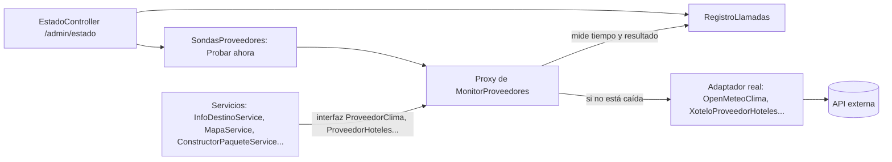

# Estado de las APIs (panel de salud)

Integrante 3. Panel para el administrador en `/admin/estado` (pestaña **Estado APIs**).

TravelGo depende de varias APIs externas: Open-Meteo (clima y ubicación), Wikipedia (fotos y atracciones),
Xotelo (hoteles), Geoapify (lugares del mapa), open.er-api (dólar a pesos) e Ignav (vuelos). El panel muestra,
en vivo, cómo está cada una y qué hace la app cuando una falla.

## Qué muestra cada tarjeta

- **Semáforo** (ícono + texto, nunca solo color):
  - **Bien**: la última llamada respondió rápido y no hubo fallas en las últimas 10.
  - **Atención**: respondió, pero lenta (más de 2,5 s), hubo fallas recientes, o Ignav respondió vacío.
  - **Falló**: la última llamada falló (sin conexión, cuota agotada, llave inválida, respuesta rara).
  - **Caída simulada**: el administrador la "cayó" desde el panel.
  - **Sin uso aún**: nadie la ha usado desde que arrancó la app.
- **Latencia** de la última llamada, promedio, % que respondió y hace cuánto fue.
- **Gráfico**: una barra por cada una de las últimas 20 llamadas (alto = cuánto tardó; violeta = respondió,
  amarillo = sin resultados, rojo = falló, naranja = caída simulada). Al pasar el mouse dice el tiempo.
- **Si se cae, ¿qué hace TravelGo?**: el plan B de esa API (caché, aviso, seguir sin ese dato) y su cuota.
- Solo aparecen las APIs que la app usa (por ejemplo, Wikipedia **o** OpenTripMap para las atracciones).

## Cómo funciona

- **`MonitorProveedores`** (un `BeanPostProcessor`) envuelve cada adaptador en un **proxy** de Spring
  (`ProxyFactory`, sin dependencias nuevas). Los servicios siguen usando las mismas interfaces y los
  adaptadores no cambian: **patrón Proxy/Decorador** y **abierto/cerrado** (los adaptadores son de varios
  integrantes y ninguno se tocó).
- **Dónde está cada caché.** Clima, ubicación, fotos y atracciones tienen la caché en `InfoDestinoService`
  (antes del proxy): cada llamada medida es una consulta real. **Xotelo, Geoapify e Ignav** tienen la caché
  **dentro** del adaptador, así que el proxy también ve las respuestas de su caché: las que tardan menos de
  10 ms (ninguna consulta real por internet es tan rápida) se marcan **"desde su caché"** (gris) y no cuentan
  para la latencia ni para el semáforo.
- **Solo mide llamadas reales.** No hay pruebas automáticas cada X segundos: gastarían cuota.
  **"Probar ahora"** hace una consulta pequeña a mano (Valledupar), por el mismo adaptador y el mismo proxy.
  **Ignav nunca se prueba**: tiene 1.000 consultas compartidas que no se recuperan.
- **`RegistroLlamadas`** guarda en memoria las últimas 50 llamadas de cada API y calcula el semáforo.
  Es un panel en vivo, no un historial: al reiniciar la app empieza de cero.
- **Caída simulada**: el proxy falla **igual que la API real sin internet**, según cómo falla cada adaptador:
  - destinos (clima, fotos, atracciones): `ProveedorExternoException`;
  - hoteles, lugares y tasa de cambio: `ProveedorNoDisponibleException`;
  - Ignav: no lanza nada, devuelve una lista vacía o `null` (así se comporta el adaptador real).
  Así los planes B que se ven son los de verdad, no una pantalla de mentira. En Xotelo, Geoapify e Ignav la
  caída simulada también apaga su caché interna: muestra el **peor caso** (sin internet y sin nada guardado).

> **Hallazgo:** `IgnavProveedorVuelos` esconde sus errores (los escribe en el log y devuelve vacío), así que
> para el panel "sin resultados" de Ignav es una señal de alerta (semáforo en Atención). Recomendación para el
> Integrante 1: que lance una excepción y el servicio decida qué mostrar.

## Guion de demo (para la sustentación)

Mejor que apagar el WiFi: apagar el WiFi también tumba el túnel y los celulares del público.

1. Abrir **Estado APIs** y tocar **Probar todas**: todo en verde, con su latencia real.
2. En otra pestaña, abrir el detalle de un paquete (clima, foto, atracciones).
3. En el panel, **Simular caída** de *Open-Meteo · clima*. Recargar el paquete: sigue igual, porque el clima
   está en **caché** (1 hora). Abrir un destino que no se haya visto: sale sin clima y con un aviso claro;
   la página no se rompe.
4. **Simular sin internet**: todas las tarjetas en naranja. Abrir el mapa: no se rompe, muestra un aviso por
   cada categoría que falló (peor caso, sin su caché). El constructor de paquetes avisa que no hay hoteles ni
   tasa de cambio. Los paquetes que ya se vieron siguen mostrando clima, foto y atracciones desde la caché.
5. **Volver a conectar todo** y **Probar todas**: vuelve a verde.

Mensaje: la app depende de APIs gratuitas que pueden fallar, y está diseñada para **degradarse con gracia**
(cachés, avisos, datos opcionales) en vez de romperse.

## Rutas

| Ruta | Qué hace |
|---|---|
| `GET /admin/estado` | Página del panel (se actualiza sola cada 3 s) |
| `GET /admin/estado/datos` | JSON con el estado de cada API |
| `POST /admin/estado/{id}/probar` | Consulta pequeña a esa API (no existe para Ignav) |
| `POST /admin/estado/probar-todas` | Igual, a todas las que se pueden probar |
| `POST /admin/estado/{id}/caida?activa=true\|false` | Simular o quitar la caída de una API |
| `POST /admin/estado/sin-internet?activa=true\|false` | Simular o quitar la caída de todas |

Todo bajo `/admin/**`: solo el rol ADMINISTRADOR (regla que ya existe en `SecurityConfig`).
