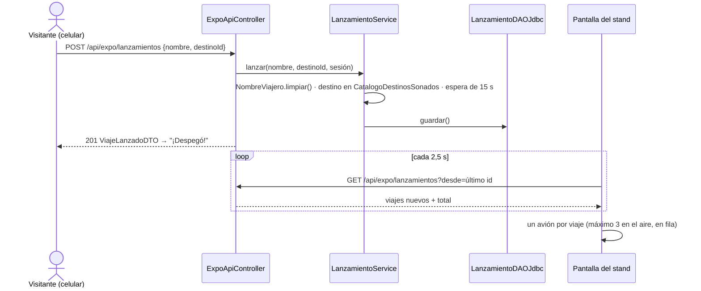

# Lanza tu viaje (ExpoSoftware)

Integrante 3. Experiencia para el stand de la ExpoSoftware: el público participa desde su celular.

El recorrido acompaña al visitante de principio a fin:

1. **Pantalla del stand:** globo 3D de TravelGo y un código QR. Siempre hay aviones en el aire: los reales
   de los visitantes y un tráfico de fondo que sale en momentos y cantidades al azar.
2. **Celular, elegir:** el visitante escanea el QR, escribe su nombre y elige su destino soñado (22 destinos).
3. **Vuelo en vivo:** su avión sale de **Valledupar** en la pantalla grande con su nombre, y al mismo tiempo
   el celular muestra un mini globo que sigue al avión, con los km que faltan (VUP → CDG).
4. **Aterrizaje:** el celular pasa solo a la página de su destino con **datos reales**: foto (Wikipedia),
   clima de hoy y pronóstico (Open-Meteo), atracciones y un pase de abordar con su nombre.
   Mientras el avión vuela se pide esa página por adelantado: el vuelo esconde lo que tardan las APIs.
5. **Venta:** si TravelGo vende ese destino (Cartagena, Bogotá, Cusco, Cancún), ve los paquetes con precio y
   entra a reservar. Si no, ve cuántas personas sueñan con ese destino hoy (los más soñados son los próximos
   paquetes que se arman).
6. **Contacto:** deja su celular (WhatsApp) para recibir su postal del viaje y ofertas, con autorización
   explícita (Ley 1581 de 2012) y un botón para borrarlo.
7. **Administración:** embudo del stand en vivo (lanzaron → vieron su destino → dejaron su celular → abrieron
   un paquete), contactos con enlace directo a WhatsApp y moderación de nombres.

## Páginas y API

| Ruta | Quién | Qué hace |
|---|---|---|
| `/expo/pantalla` | público | Pantalla del stand: globo, QR, contador, ranking y avisos. Tecla **F** = pantalla completa |
| `/expo/pantalla?demo` | público | Igual, pero con visitantes simulados y sin base de datos (para ensayar) |
| `/expo` | público | Página del celular: nombre + destino + "Lanzar" + vuelo en vivo |
| `/expo/viaje/{id}` | público | Página del destino al aterrizar: datos reales, paquetes y contacto (el contacto solo lo ve quien lanzó) |
| `/expo/viaje/{id}/paquete/{p}` | público | Cuenta "abrió un paquete" en el embudo y lleva a `/catalogo/{p}` |
| `/expo/qr.svg` | público | QR con la dirección de `/expo` |
| `/admin/expo` | ADMINISTRADOR | Dirección pública del QR (túnel), embudo del stand, contactos (WhatsApp) y moderación |
| `GET /api/expo/destinos` | público | Destinos que se pueden elegir |
| `POST /api/expo/lanzamientos` | público | `{ "nombre": "Ana", "destinoId": "paris" }` → 201 con el viaje |
| `GET /api/expo/lanzamientos?desde=N` | público | `desde=0`: los últimos 500; si no, los nuevos con id > N. Incluye `total` |
| `POST /api/expo/lanzamientos/{id}/contacto` | el celular que lanzó | `{ "telefono": "300 123 4567", "autoriza": true }` → número enmascarado |
| `DELETE /api/expo/lanzamientos/{id}/contacto` | el celular que lanzó | Borra el celular |

Errores (formato del `GlobalExceptionHandler`):
- 400: nombre inválido (menos de 2 o más de 20 caracteres, números o símbolos, groserías).
- 404: destino que no está en la lista.
- 409: el mismo celular lanzó otro viaje hace menos de 15 segundos.
- 400 en el contacto: sin autorización, número inválido o el viaje no se lanzó desde ese celular.

## Pantalla: torre de control

Con 30 o más lanzamientos a la vez, que todos salgan juntos se ve desordenado. La pantalla funciona como
una torre de control (`expo-pantalla.js`):

- **Una sola pista:** entre dos despegues hay al menos 0,28–0,65 s (con un poco de azar). Con la fila llena
  la separación se acorta para vaciarla rápido, pero nunca salen todos al tiempo.
- **Prioridad a los reales:** máximo 8 vuelos reales en el aire; los demás esperan su turno.
- **Grupos:** si más de 5 personas en la fila van al mismo destino, sale **un solo avión** más grande
  ("Ana y 5 más") y el aviso dice "6 personas van a París: Ana, Luis, Sara, Tom y 2 más".
- **Tráfico de fondo:** solo cuando no hay nadie esperando, sin nombres, más pequeño y tenue.
- Probar el peor caso: `/expo/pantalla?demo&rafaga` (30–40 lanzamientos cada 20 s).

## WhatsApp

WhatsApp no deja que una empresa le escriba primero a una persona (anti-spam). La persona tiene que escribirle
al número de la empresa; desde ese momento hay 24 horas para responderle con mensajes libres (texto e imagen).

Para la expo se usa el **sandbox de WhatsApp de Twilio** (gratis, funciona con la cuenta de prueba):

1. En la página de su destino, el visitante deja su celular y marca la autorización.
2. Toca **Activar WhatsApp**: se abre WhatsApp con "join palabra-palabra" ya escrito para el número del
   sandbox (+1 415 523 8886). Lo envía (solo una vez; dura 3 días).
3. Al volver al navegador, TravelGo le envía solo su viaje: foto del destino, clima de hoy, paquetes con
   precio y enlace, y el enlace a su página. La página muestra el estado real: enviando → entregado.
   Si envió antes de que WhatsApp registrara la activación, se reintenta solo.

Configuración (variables de entorno, en la misma terminal donde se arranca la app):

| Variable | Valor |
|---|---|
| `TWILIO_ACCOUNT_SID`, `TWILIO_AUTH_TOKEN` | Las mismas del SMS (consola de Twilio) |
| `TRAVELGO_WHATSAPP_CODIGO` | El código del sandbox tal como sale en la consola: `join palabra-palabra` |
| `TRAVELGO_WHATSAPP_NUMERO` | Opcional. Por defecto el del sandbox, `+14155238886` |

Sin estas variables la app funciona igual: el visitante puede dejar su celular, pero no recibe nada, y
`/admin/expo` muestra el aviso "WhatsApp desactivado".

Límites: la cuenta de prueba de Twilio tiene pocos mensajes gratis (entre 50 por día y 100 en total, según la
documentación de Twilio). Para producción: número propio de WhatsApp Business con plantillas aprobadas por Meta
(Twilio o la API oficial de Meta). Solo cambia el adaptador `TwilioWhatsApp`, detrás de la interfaz `CanalWhatsApp`.

## Datos personales (Ley 1581 de 2012)

- El celular es **opcional** y se pide después de aterrizar, diciendo para qué se usa (postal y ofertas).
- Sin marcar la autorización no se guarda (lo valida el servidor, no solo la página).
- Nunca sale en la pantalla ni en la API pública; al navegador vuelve **enmascarado** (+57 300 ••• 4567).
- Solo el celular que lanzó el viaje puede guardarlo o borrarlo (la sesión recuerda sus viajes: `SesionExpo`).
- El visitante lo borra desde su página; el administrador también puede borrarlo si se lo piden.

## Diseño

- Paquete `com.travelgo.expo`. Tabla `lanzamiento_expo` en `schema.sql`.
- **Destinos fijos en Java** (`CatalogoDestinosSonados`), no la tabla `destino`: el visitante puede soñar
  con Tokio aunque no haya paquetes allí, y cada destino necesita coordenadas para el globo.
- **Polling, no WebSocket:** una consulta cada 2,5 s es suficiente para una pantalla y es más fácil de
  explicar y de recuperar si el WiFi se cae (la pantalla muestra "Reconectando…" y sigue sola).
- **Moderación:** `NombreViajero` acepta solo letras y bloquea groserías comunes (raíces cortas al inicio
  de una palabra, para no bloquear "Mari Carmen"; raíces largas en cualquier parte). Lo que se escape se
  oculta en `/admin/expo`; la pantalla recarga todo cada minuto y lo quita.
- **QR en el servidor** con ZXing (`GeneradorQr`): no depende de un CDN.
- **Globo compartido:** `static/js/globo.js` dibuja el globo (proyección ortográfica en `<canvas>`, continentes
  de Natural Earth, arcos y aviones). Lo usan la intro de la página de inicio (`intro.js`) y la pantalla
  (`expo-pantalla.js`). La pantalla y el celular usan `css/expo.css` sin Bootstrap.

GRASP/SOLID: `LanzamientoService` es el **controlador** de las reglas (los controladores web solo traducen
HTTP); `CatalogoDestinosSonados` es el **experto** en los destinos; el servicio depende de la interfaz
`LanzamientoDAO` (**inversión de dependencias**: las pruebas usan un DAO en memoria y un reloj manual).

## Cómo montarlo en la expo

Con la IP del portátil solo entran celulares del mismo WiFi, y muchas redes (universidad, eventos) bloquean
la conexión entre equipos; además el firewall de Windows puede bloquear el puerto 8080. Por eso en la expo se
usa un **túnel de Cloudflare** (gratis, sin cuenta): da una dirección `https://….trycloudflare.com` con la
que entra cualquier celular, con WiFi o datos móviles.

1. Iniciar PostgreSQL y la app: `./mvnw spring-boot:run`.
2. En otra terminal abrir el túnel: `cloudflared tunnel --url http://localhost:8080`.
   Copiar la dirección `https://….trycloudflare.com` que aparece en el recuadro. La terminal debe quedar
   abierta todo el día (si se cierra, el túnel se apaga).
3. Entrar como administrador → menú **QR Expo** (`/admin/expo`) → pegar la dirección → **Guardar**.
   El aviso verde confirma que entra cualquier celular, y se ve el QR para probarlo.
4. Menú **Pantalla Expo** → se abre la pantalla en otra pestaña. Llevarla al monitor grande y pulsar **F**.
5. Probar con un celular con **datos móviles** antes de que llegue el público.
6. Dejar `/admin/expo` abierto en otra pestaña para ocultar nombres.

Notas:
- La dirección del túnel **cambia cada vez** que se abre `cloudflared`, y la app la olvida al reiniciarse:
  repetir el paso 3 en esos casos.
- Si la pantalla se abre directamente por la dirección del túnel, el QR la toma solo (lee `X-Forwarded-Host`
  y `X-Forwarded-Proto`), aunque no se haya pegado en el admin.
- Si la app se despliega en internet, se puede fijar con `travelgo.expo.url-publica=https://...`.
- La pantalla muestra un aviso amarillo mientras el QR solo sirva en el WiFi local.

Para borrar los viajes de prueba antes del evento: `DELETE FROM lanzamiento_expo;` en PostgreSQL.
