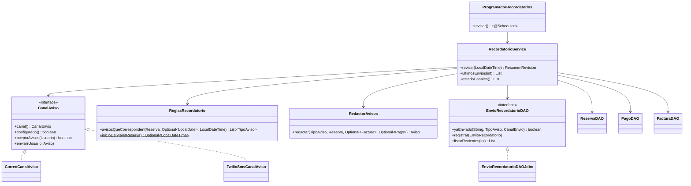
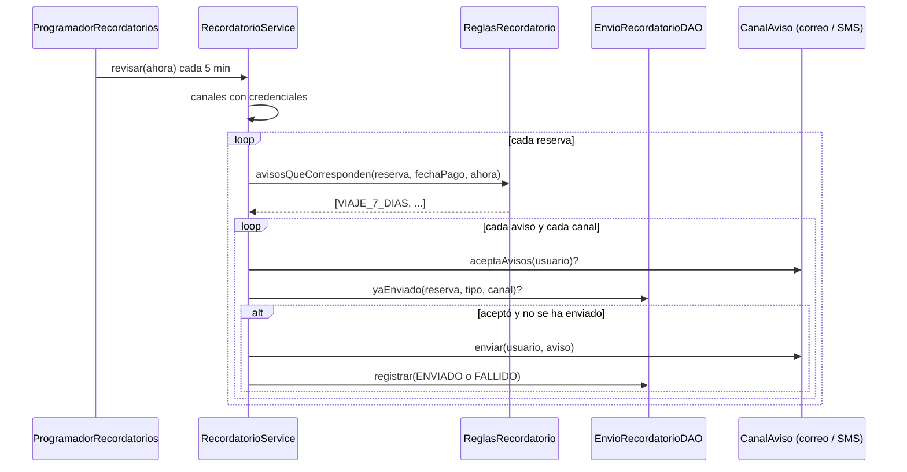

# Recordatorios por correo y SMS, y widget del chatbot — Sprint 5 (Integrante 3)

Rama: `feature/recordatorios`. Este documento tiene el diseño de los recordatorios, la investigación del proveedor de
SMS, cómo configurarlos y probarlos, y el widget del chatbot en la web.

## 1. Qué se hizo

| Tarea del Sprint 5 | Estado |
|---|---|
| Servicio programado que revisa las reservas, decide a quién avisar y registra cada envío | Hecho: `RecordatorioService` + `ProgramadorRecordatorios` (`@Scheduled`) |
| Canal de correo (SMTP) y canal de SMS detrás de una interfaz común | Hecho: `CanalAviso` con `CorreoCanalAviso` y `TwilioSmsCanalAviso` |
| Investigación del proveedor de SMS | Hecha (2026-11-22). Resultado en la sección 3 |
| Widget del chatbot en la web | Hecho: `fragments/chatbot.html` + `js/chatbot.js` + `css/chatbot.css`. Necesita el PR #41 (motor del chatbot, Integrante 4) |
| Preferencias de aviso en la interfaz (pendiente heredado de la semana 10) | Hecho: campos en el registro y página "Mis avisos" (`/perfil/avisos`) |
| Panel para el administrador | Hecho: `/admin/recordatorios` (estado de los canales, últimos envíos y botón "Revisar ahora") |

Depende de: tabla `envio_recordatorio` (PR #40, Integrante 4), y teléfono, preferencias y fecha de entrada del hotel
(Integrante 1, ya en `develop`).

## 2. Diseño

### Avisos

| Aviso (`TipoAviso`) | Cuándo |
|---|---|
| `VIAJE_7_DIAS` | Faltan entre 7 días y 1 día para la salida |
| `VIAJE_1_DIA` | Falta 1 día o menos (y más de unas horas) |
| `VIAJE_HORAS` | Faltan `travelgo.recordatorios.horas-antes` horas o menos (por defecto 6) |
| `PAGO_PENDIENTE` | Reserva PENDIENTE, sin pago, creada hace `travelgo.recordatorios.dias-pago-pendiente` días o más (por defecto 2) |
| `PAGO_CONFIRMADO` | La reserva tiene un pago de hoy o de ayer; el correo lleva el resumen de la factura (número, subtotal, cupón, total, método) |

- **La salida del viaje** es lo primero entre: la salida de los vuelos, la fecha del transporte y la entrada al hotel
  (a las 15:00 de su fecha de entrada, la hora típica de check-in).
- **Las ventanas no se pisan:** si alguien reserva 3 horas antes del vuelo, solo recibe el aviso de "unas horas".
- **Las reservas canceladas** no reciben avisos.
- **Pagos viejos:** solo se confirma un pago de hoy o de ayer, para no mandar correos atrasados la primera vez que
  arranca el servicio con datos antiguos.
- **Confirmación del pago:** no se tocó `PagoService` (Integrante 2). El programador encuentra el pago en la siguiente
  revisión (cada 5 minutos) o al pulsar "Revisar ahora" en `/admin/recordatorios`.

### Clases



### Secuencia de una revisión



### Registro de envíos

Tabla `envio_recordatorio` (Integrante 4) con `UNIQUE (reserva_id, tipo, canal)`: el mismo aviso de una reserva sale
una sola vez por canal. Si el envío falla se guarda `FALLIDO` y se reintenta en la próxima revisión; al salir bien, la
misma fila pasa a `ENVIADO` (`INSERT ... ON CONFLICT DO UPDATE`).

### SOLID y GRASP

| Principio | Dónde |
|---|---|
| Inversión de dependencias (D) | `RecordatorioService` recibe una `List<CanalAviso>`; no conoce el correo ni Twilio |
| Abierto/cerrado (O) | Un canal nuevo (WhatsApp, Telegram) es otra clase `@Component` que implementa `CanalAviso`; el servicio no cambia |
| Segregación de interfaces (I) | `CanalAviso` tiene 4 métodos pequeños; `EnvioRecordatorioDAO` solo lo que necesitan los recordatorios |
| Responsabilidad única (S) | Reglas (`ReglasRecordatorio`), textos (`RedactorAvisos`), envío (canales), registro (DAO) y horario (`ProgramadorRecordatorios`) están separados |
| Adapter / Protected Variations | `TwilioSmsCanalAviso` traduce un `Aviso` a la API de Twilio; cambiar de proveedor toca solo esa clase |
| Experto en información | Las reglas usan los datos que ya tienen `Reserva`, `Vuelo`, `Hotel` y `Transporte` |
| Fabricación pura | `RedactorAvisos` y `ReglasRecordatorio` no son del dominio; existen para mantener el servicio simple |

## 3. Investigación del proveedor de SMS (2026-11-22)

Criterios del sprint: funciona en Colombia, tiene plan gratuito o muy barato, permite el uso académico y no exige
contrato comercial.

| Proveedor | Plan gratis | Límites de la prueba | Colombia | Resultado |
|---|---|---|---|---|
| Twilio | Cuenta de prueba: 100 SMS gratis, 30 días | Solo a números verificados (hasta 5). **El texto debe ser una plantilla de Twilio**: no deja mandar mensajes propios en la prueba | Sí (precio por SMS en su página de precios de Colombia; fuentes externas citan ~US$0,05) | **No pasa gratis.** Con cuenta paga sí funciona; el adaptador ya está hecho |
| Vonage (Nexmo) | €2 de crédito | Solo a números de prueba registrados; agrega "[FREE SMS DEMO, TEST MESSAGE]" al texto | Sí | Pasa con límites: serviría solo para una demostración a nuestro propio celular |
| Brevo | No (paquetes de 100 créditos que se compran) | — | Sí (envío entre 8 a. m. y 9 p. m.) | No pasa (no es gratis) |

**Decisión (a confirmar en el equipo):** según la regla del sprint ("si no hay una opción gratuita viable, el SMS se
deja como canal documentado y el correo cubre los avisos"), **el correo cubre los avisos** y el SMS queda como canal
documentado y listo: `TwilioSmsCanalAviso` funciona en cuanto se pongan credenciales de una cuenta paga. Si el equipo
quiere mostrar un SMS en la sustentación, la opción más barata es el crédito de prueba de Vonage (hay que escribir un
adaptador `VonageSmsCanalAviso`, igual al de Twilio).

Fuentes: [Twilio – cuenta de prueba](https://www.twilio.com/docs/usage/tutorials/how-to-use-your-free-trial-account),
[Twilio – precios de SMS en Colombia](https://www.twilio.com/en-us/sms/pricing/co),
[Vonage – números de prueba](https://api.support.vonage.com/hc/en-us/articles/204014853),
[Brevo – países y precios de SMS](https://help.brevo.com/hc/en-us/articles/208717449).

## 4. Configuración

Todo va en variables de entorno con valor por defecto vacío. **Sin ellas la aplicación arranca igual** y en el log sale
"Recordatorios por correo desactivados: falta MAIL_HOST..." (lo mismo para el SMS).

Líneas para `config/application.properties` (cada integrante, no se sube a Git):

```properties
# --- Sprint 5: recordatorios (docs/recordatorios.md) ---
spring.mail.host=${MAIL_HOST:}
spring.mail.port=${MAIL_PORT:587}
spring.mail.username=${MAIL_USERNAME:}
spring.mail.password=${MAIL_PASSWORD:}
spring.mail.properties.mail.smtp.auth=true
spring.mail.properties.mail.smtp.starttls.enable=true
travelgo.recordatorios.correo.remitente=${TRAVELGO_CORREO_REMITENTE:}
travelgo.recordatorios.correo.redirigir-a=${TRAVELGO_CORREO_REDIRIGIR_A:}
travelgo.recordatorios.sms.twilio.account-sid=${TWILIO_ACCOUNT_SID:}
travelgo.recordatorios.sms.twilio.auth-token=${TWILIO_AUTH_TOKEN:}
travelgo.recordatorios.sms.twilio.numero-origen=${TWILIO_NUMERO_ORIGEN:}
travelgo.recordatorios.sms.redirigir-a=${TRAVELGO_SMS_REDIRIGIR_A:}
```

| Propiedad | Por defecto | Para qué |
|---|---|---|
| `travelgo.recordatorios.activo` | `true` | `false` apaga el programador (la página del admin sigue funcionando) |
| `travelgo.recordatorios.intervalo-ms` | `300000` (5 min) | Cada cuánto se revisan las reservas |
| `travelgo.recordatorios.retraso-inicial-ms` | `60000` (1 min) | Espera después de arrancar |
| `travelgo.recordatorios.horas-antes` | `6` | Ventana del aviso `VIAJE_HORAS` (1 a 23) |
| `travelgo.recordatorios.dias-pago-pendiente` | `2` | Días sin pagar antes del aviso de pago pendiente |
| `travelgo.recordatorios.sms.codigo-pais` | `+57` | Se agrega a los celulares escritos sin "+" |

### Correo con Gmail (para la demostración)

1. En la cuenta de Google del equipo: activar la verificación en dos pasos y crear una **contraseña de aplicación**.
2. Variables de entorno (PowerShell, solo en esa terminal):

```powershell
$env:MAIL_HOST = "smtp.gmail.com"
$env:MAIL_USERNAME = "cuenta.del.equipo@gmail.com"
$env:MAIL_PASSWORD = "la contraseña de aplicación"
$env:TRAVELGO_CORREO_REMITENTE = "cuenta.del.equipo@gmail.com"
$env:TRAVELGO_CORREO_REDIRIGIR_A = "cuenta.del.equipo@gmail.com"   # modo prueba: todo llega aquí
./mvnw spring-boot:run
```

**Nunca se escribe a usuarios reales en las pruebas:** con `TRAVELGO_CORREO_REDIRIGIR_A` todos los correos van a esa
dirección y el asunto dice para quién eran (`[Prueba, para cliente@travelgo.com] ...`). Lo mismo para el SMS con
`TRAVELGO_SMS_REDIRIGIR_A`.

## 5. Cómo probarlo

1. Iniciar sesión como `cliente@travelgo.com`, abrir **Mis avisos** y activar "Avisos por correo".
2. Hacer una reserva y pagarla (cupón `VERANO10`).
3. Iniciar sesión como `admin@travelgo.com` → **Administración → Recordatorios → Revisar ahora**.
4. Llega el correo "Pago confirmado" con el resumen de la factura, y en la tabla aparece la fila `Enviado`.
5. Pulsar "Revisar ahora" otra vez: no se repite.

Pruebas automáticas (sin red ni base de datos): `ReglasRecordatorioTest`, `RecordatorioServiceTest` (canales falsos,
nunca envía de verdad) y `TwilioSmsCanalAvisoTest`.

## 6. Widget del chatbot

- Botón flotante en todas las páginas, **solo con sesión iniciada** (el endpoint `/api/chatbot` exige sesión). Se
  incluye una sola vez desde `fragments/layout :: scripts`, así que no hubo que tocar las 16 plantillas.
- Sigue el contrato de `docs/chatbot_contrato.md` (Integrante 4): `POST /api/chatbot` con el token CSRF en la cabecera
  y `GET /api/chatbot/{sesionId}/mensajes` para recargar la conversación al abrir el widget.
- La respuesta se muestra con `textContent` (nunca como HTML) y `white-space: pre-line` para respetar los `\n`.
- Los botones de sugerencia envían su texto como un mensaje nuevo.
- El `sesionId` se guarda en `sessionStorage` (vive mientras la pestaña esté abierta). El botón ↺ empieza una
  conversación nueva.
- Errores: 400 (mensaje vacío o muy largo), sesión vencida (Spring redirige al login → el widget lo detecta y lo dice),
  404 (el servidor aún no tiene el motor) y sin conexión.
- No se imprime con la factura (`@media print`).
